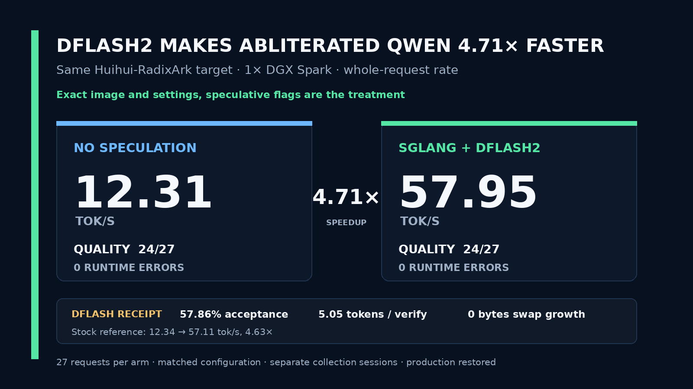

# Qwen3.8-27B Huihui abliterated NVFP4-lm_head + DFlash2 on one DGX Spark

## Run it

```bash
git clone https://github.com/sxuff/qwen38-huihui-abliterated-dflash2-dgx-spark && cd qwen38-huihui-abliterated-dflash2-dgx-spark && ./run.sh
```

Expected: **57.95 tok/s** median whole-request completion rate, single stream, prefill included (12.31 tok/s without DFlash2) — receipt: [`evidence/huihui-nospec-study.json`](evidence/huihui-nospec-study.json)

A pinned DGX Spark recipe showing that SGLang + DFlash2 raises the same abliterated `edp1096/Huihui-RadixArk-Qwen3.8-27B-abliterated-NVFP4` target from **12.31 tok/s to 57.95 tok/s**, a measured **4.71×** whole-request acceleration.

The target uses ModelOpt NVFP4 W4A4 for the `lm_head` and all 192 language-model MLP projections, FP8 for attention and Gated DeltaNet projections, and BF16 for vision and MTP tensors. The repository packages the exact runtime, artifact verification, benchmark fixtures, safety gates, authenticated deployment, and rollback receipts used on one NVIDIA GB10.

## Status



[Read the technical report](REPORT.md) · [Inspect the no-spec receipt](evidence/huihui-nospec-study.json) · [Inspect the exact comparison ledger](evidence/cross-study-comparison.json)

| Huihui-RadixArk mode | Median whole-request rate | Frozen automatic quality | Runtime errors |
|---|---:|---:|---:|
| No speculation | 12.31 tok/s | 24/27 | 0/27 |
| **SGLang + DFlash2** | **57.95 tok/s** | **24/27** | **0/27** |

**Measured DFlash2 acceleration: 4.71×.** The no-spec follow-up used the exact qualified image, target, fixture bytes, sampler, and server settings with only the speculative-decoding flags removed. The no-spec and DFlash2 arms were collected in separate sessions, so this is a matched-configuration historical-session comparison rather than a same-session paired estimate.

Equal automatic-quality totals do not imply output parity. **9/27 assembled assistant envelopes were byte-identical** across arms; visible content matched in 12/27 and completion-token counts matched in 15/27. Exact token-ID parity is unmeasured because the frozen streaming harness did not retain output token IDs. See [`evidence/huihui-cross-arm-parity.json`](evidence/huihui-cross-arm-parity.json).

### External references

| Target | No speculation | SGLang + DFlash2 | DFlash2 ratio |
|---|---:|---:|---:|
| Stock RadixArk | 12.34 tok/s | 57.11 tok/s | 4.63× |
| **Huihui-RadixArk abliterated** | **12.31 tok/s** | **57.95 tok/s** | **4.71×** |
| Aday ARA abliterated | 12.33 tok/s | 41.44 tok/s | 3.36× |

Stock remains the primary external speed reference. Huihui's 57.95 tok/s is effectively stock-level performance, measuring 1.46% above stock across separate studies. Aday remains the exact-image frozen promotion control and a secondary operational reference.

Operational evidence for the no-spec follow-up:

- Complete requests: **27/27**
- Frozen automatic quality: **24/27**, matching DFlash2
- Runtime errors: **0/27**
- Speculative flags present: **false**
- Minimum host `MemAvailable`: **31,633,780,736 bytes**
- Swap growth: **0 bytes**
- Production DFlash2 service restored and generation-tested

The no-spec receipt is [`evidence/huihui-nospec-study.json`](evidence/huihui-nospec-study.json). The exact post-hoc stock, Huihui, and Aday values and source-summary hashes are in [`evidence/cross-study-comparison.json`](evidence/cross-study-comparison.json).

The formal control remains the completed, output-redacted Aday DFlash2 arm from [`sxuff/qwen38-27b-abliterated-nvfp4-dflash2-dgx-spark`](https://github.com/sxuff/qwen38-27b-abliterated-nvfp4-dflash2-dgx-spark), pinned in [`controls/aday-dflash2-control.json`](controls/aday-dflash2-control.json). It preserves the original promotion decision without making Aday the headline baseline.

## Frozen promotion gates

The candidate must satisfy all of these:

- 27/27 unique requests complete with zero runtime errors.
- Every normalized request payload hash matches the historical control after removing only the required `model` identifier. Full payload hashes must differ because the served model names differ.
- Median whole-request completion rate is at least 1.10× the historical Aday DFlash2 result of 41.4351 tok/s.
- At least 23/27 frozen automatic-quality checks pass, matching or exceeding the historical control.
- All 18 performance rows have finite positive rates, all 27 rows have positive completion-token counts and expected finish reasons, and every stream reports the exact candidate model alias.
- DFlash2 activity is confirmed by a positive verification-call delta during the 27 measured requests.
- Host `MemAvailable` remains at least 15 GiB.
- Swap growth remains at or below 512 MiB.

The full contract is in [`protocol.json`](protocol.json).

## Pinned components

- Candidate: `edp1096/Huihui-RadixArk-Qwen3.8-27B-abliterated-NVFP4@21565d389fe573a32c1c425e0c7ade204ddb2263`
- Behavioral source: `huihui-ai/Huihui-Qwen3.8-27B-abliterated`
- DFlash2 draft: `z-lab/Qwen3.8-27B-DFlash2@50307d4c4cde6860d4eee73e2547cd786fe8e8a4`
- Benchmark runtime image: exact historical control `sha256:d551df08e966aee2fbac67c231f4c7dfad291b02d3b5e59f082f753c85cd33dd`
- Candidate-labeled image built as an attribution check: `sha256:b1dc79ca75f22c3f12e53cd096880a116ca80bcd97a66dab151dc78170831512`. The qualified service deliberately reuses the exact benchmark image above so runtime identity remains matched.
- Hardware: one NVIDIA DGX Spark GB10

## Precision policy

Verified against the pinned Hub configuration and model index:

| Component | Precision |
|---|---|
| 192 language-model MLP projections | NVFP4 W4A4, group size 16 |
| `lm_head` | NVFP4 W4A4, group size 16 |
| 208 attention and Gated DeltaNet projections | FP8 |
| Vision tower | BF16 |
| MTP tensors | BF16 |

The inspection receipt is [`evidence/candidate-inspection.json`](evidence/candidate-inspection.json) and is independently reproduced offline by `scripts/inspect_candidate.py` from the pinned Hub metadata included in `evidence/hub-metadata/`.

## Download and verify

```bash
python3 scripts/download.py target \
  --destination "$HOME/models/Huihui-RadixArk-Qwen3.8-27B-abliterated-NVFP4-21565d389fe5/snapshot" \
  --reserve-gib 8

python3 scripts/download.py draft \
  --destination "$HOME/models/Qwen3.8-27B-DFlash2-50307d4c4cde"
```

Every expected file, byte count, and SHA-256 digest is frozen in `manifests/` and checked before launch.

## Reproduce the 4.71× comparison

The checked-in DFlash2 arm is the qualified 27-request result in `results/summary.json`. Re-run the same target without speculative decoding and compare it with that frozen arm:

```bash
MODEL_DIR=/path/to/candidate/snapshot \
RUN_ROOT="$PWD/private/no-spec-followup" \
./scripts/run_nospec_followup.sh
```

The follow-up runner verifies the contract, image, and checkpoint; generation-tests any active Huihui production service; stops it; launches the same target with no speculative flags; collects 27 requests under the memory watchdog; calculates the DFlash2 ratio; then restores and generation-tests production. It refuses to overwrite an existing result and only removes its exactly owned study container.

The original one-arm promotion harness remains in `scripts/run_study.sh` for provenance with its frozen Aday control, protocol, and report. It is supporting qualification machinery, not the primary reproduction path. The primary technical report is [`REPORT.md`](REPORT.md); the original promotion report is preserved at [`evidence/promotion-report-v3.md`](evidence/promotion-report-v3.md).

## Install the qualified service

Benchmark and production use the exact historical runtime image. Its executable root filesystem is identical to the candidate-labeled image; target identity is instead enforced through the hash-verified mounted checkpoint, served-model receipt, and deployment canaries.

```bash
QWEN38_PROXY_KEY_FILE="$HOME/.config/qwen38/proxy.key" ./scripts/install_service.sh
systemctl --user enable --now \
  qwen38-huihui-radixark-dflash2.service \
  qwen38-huihui-radixark-dflash2-proxy.service
```

SGLang binds only to `127.0.0.1:8002`. The Docker-bridge client endpoint at `172.17.0.1:8001` requires bearer authentication.

## Metric

The primary rate is completion tokens divided by whole request wall time. It includes prefill and first-token latency. Streaming chunks may contain multiple speculative tokens, so the repository does not infer a synthetic post-first-token decode rate from chunk arrival times.

## Reproduce repository checks

```bash
./scripts/ci.sh
```

## License and attribution

Repository-authored material is MIT-licensed. The SGLang compatibility overlay remains under Apache-2.0; see [`NOTICE`](NOTICE) and [`THIRD_PARTY_LICENSES/Apache-2.0.txt`](THIRD_PARTY_LICENSES/Apache-2.0.txt). Model weights are not redistributed here.

Model and method lineage: Huihui AI supplies the abliterated behavioral source. The target card credits RadixArk's Qwen3.8 NVFP4 work and sakamakismile's Huihui NVFP4 reference. z-lab publishes the DFlash2 draft, based on DFlash2 by Inco AI. Exact links and revisions are listed in `NOTICE`.
